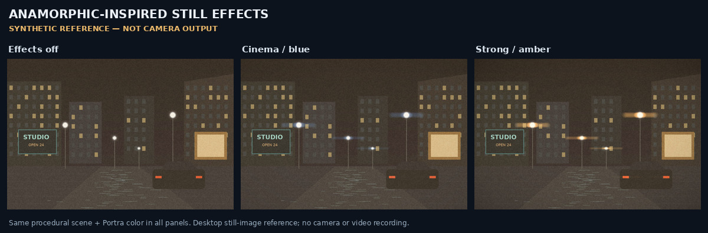
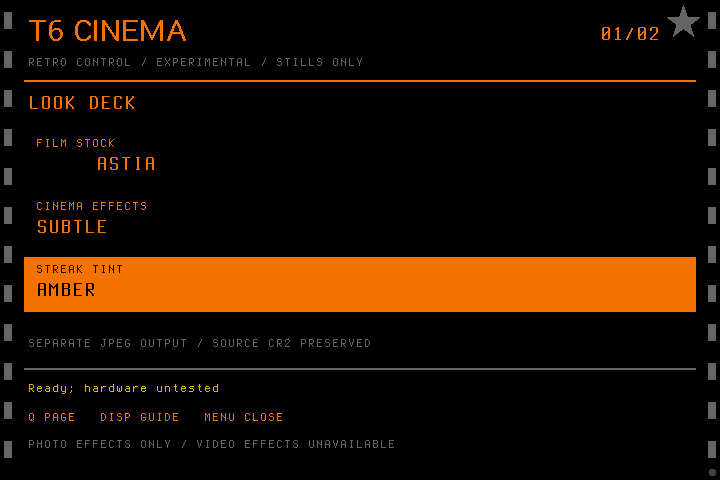

# T6 Cinema

Experimental Canon **EOS Rebel T6 / EOS 1300D / Kiss X80, firmware 1.1.0**
Magic Lantern integration with Soup film looks and anamorphic-inspired effects.

**Status: experimental; manual still processing verified on the owner's physical T6.**
Two in-camera JPEGs decoded at 2592×1728; the latest ETERNA/STRONG/BLUE image
codestream matched the same desktop render byte for byte. Two short stock
1080p29.97/720p59.94 recordings also decode successfully; sustained operation
remains unverified. The prototype processes **still photographs**. Baked-in video effects and higher
frame-rate recording are research goals, **not implemented features**. This is
not a complete Magic Lantern installer or a production-ready firmware release.

## What works in the prototype

- Native **T6 Film** menu alongside the existing Magic Lantern menus.
- An amber retro dashboard operated with the D-pad, main dial, SET, Q and DISP.
  MENU exits; shutter, AV/erase, playback, LV and zoom retain native functions.
  See the [control map and validation limits](docs/RETRO_UI.md).
- Thirteen editable Soup film recipes, grain and halation.
- Off / Subtle / Cinema / Strong effects, with blue or amber flares.
- Highlight-driven multiscale horizontal streaks, anisotropic bloom, vignette
  and subtle lateral color fringing. These do not reconstruct optical oval
  bokeh, depth of field, or an anamorphic lens's extra horizontal view.
- A manual **Develop latest** command and bounded automatic processing.
  Automatic processing always starts OFF after boot.
- Photo status reports elapsed wall time, including I/O. A manual **CPU limits
  test** compares uncached, cached and compiler-optimized synthetic YUV
  workloads with byte output checks, then writes a new CSV. These kernel
  timings do not measure saved-video FPS. See the [camera notes](integrations/magiclantern/1300D.110/README.md).
- Separate `T6F_####.JPG` outputs. Source CR2s and their embedded previews are
  opened read-only, never rewritten or deleted. Detected existing outputs are
  refused. The T6-specific creation mode and rename collisions were tested with
  the actual firmware in emulation. Physical new-file creation works; collision
  preservation still needs physical validation.
- Half-resolution embedded-JPEG processing: the tested real T6 sample produces
  **2592 × 1728** JPEGs. This is not full sensor-RAW development.
- A desktop reference using the same C renderer, plus optional center crop and
  optical desqueeze for an image actually captured through anamorphic optics.



The demonstration is a generated test scene processed by the desktop reference.
It is not evidence of physical-camera operation.



This is an emulator capture. See [emulator setup and limitations](integrations/qemu/README.md)
and the [native file-I/O investigation](docs/NATIVE_FILE_IO.md).

## Video and high frame rates

The prototype leaves Canon's recording pipeline unchanged and stops the still
worker in movie mode. It **does not bake these spatial effects into recorded
video**, apply a live video filter, enable RAW video, or increase frame rates.

Canon specifies **1920 × 1080 up to 29.97 fps**, **1280 × 720 up to 59.94 fps**,
and **640 × 480 at 29.97 fps** in NTSC mode. Lower resolution alone does not
establish a faster sensor mode. No 120/240 fps T6 mode has been validated here.
[Canon specifications](https://www.usa.canon.com/support/p/eos-rebel-t6-1).

The T6's upstream movie structures and several buffer addresses are explicitly
unverified. An LCD preview filter is not proof of an effect in the saved MOV.
See [video research](docs/VIDEO_RESEARCH.md) and [high-fps research](docs/HIGH_FPS.md).
An isolated [packed-YUV processing prototype](src/experimental/yuv_anamorphic/README.md)
uses integer highlight streaks and row scratch. The diagnostic build links it
only for owned synthetic benchmark frames. There is no encoder-frame hook, and
the T6 recording format, buffer ownership and effect throughput remain unverified.
Physical r12 timings for the uncached, size-optimized kernel are now recorded
in the [hardware baseline](docs/HARDWARE_BASELINE.md); this path exceeds video
frame intervals and does not establish maximum CPU capability.
An isolated [fixed-field observer](src/experimental/t6_video_probe/README.md)
provides bounded, timestamped observations through symbolic callbacks. It has
no native address map or camera integration and is excluded from camera builds.

The [read-only Windows camera-info tool](tools/read-only-camera-info/README.md)
confirmed the connected T6's firmware as **1.1.0** using standard PTP DeviceInfo.
See the [sanitized hardware baseline](docs/HARDWARE_BASELINE.md). This USB check
did not boot the overlay or validate video effects or higher frame rates.

## Build and try the renderer on a computer

Linux or WSL Ubuntu 24.04:

```sh
sudo apt-get update
sudo apt-get install --no-install-recommends build-essential gcc-arm-none-eabi \
  libnewlib-dev python3-pil python3-numpy git
make -C src -f Makefile.t6
cd src
./t6dev your-photo.CR2 -o your-photo-cinema.JPG \
  --stock stocks/portra.fs --anamorphic cinema --tint blue
```

JPEG inputs also work. `--anamorphic strong --tint amber` changes the effect;
`--aspect 2.39` center-crops the desktop output. Use `--desqueeze 1.33` only for
an image captured through actual 1.33× squeezed optics. These two geometry
options are desktop-only. `./t6dev --help` lists the supported arguments.
The renderer refuses existing output files, including links to the input.
RGB orientation follows the embedded preview; automatic EXIF rotation is not
implemented. Monochrome source previews cannot regain color.

## Build the experimental camera overlay

Use an exactly pinned, clean upstream Magic Lantern source checkout:

```sh
git clone https://github.com/reticulatedpines/magiclantern_simplified.git ../t6-ml
git -C ../t6-ml checkout --detach 142472e95054d73640f50789ac0fd66325499d82
python3 src/tools/build-t6.py --ml-source ../t6-ml \
  --output dist/t6-cinema-0.1.0-experimental
```

The script builds an isolated temporary source tree, preserving the upstream
checkout. It generates `AUTOEXEC.BIN`, its matching `ML/modules/t6_110.sym`, bitmap
fonts, film recipes, manifest and checksums. It never installs software, writes to a memory
card, enables a boot flag or flashes a camera. No Canon ROMs are included.
It also rejects a static ELF load/BSS footprint outside the pinned platform's
512 KiB reserve; this does not account for heap allocations or task stacks.

This is an **overlay for a matching, already-working 1300D.110 environment**,
not a complete bootable card. Do not use binaries for the 5D, 50D, T6i/750D,
T5/1200D, or another Canon firmware version. Old upstream 5D binaries were
removed from this branch's `card/` directory to prevent accidental use.
Read the [camera integration notes](integrations/magiclantern/1300D.110/README.md)
before any physical-camera experiment. Keep the original autoexec and matching
symbol file together for restoration. Compiling and mock tests do not prove
boot, playback, responsiveness, battery use or reliable camera operation.

## Verification

```sh
make -C src -f Makefile.t6 test
make -C src -f Makefile.t6 asan
make -C src -f Makefile.t6 arm
python3 src/tools/fetch_t6_sample.py  # optional CC0 reference fixture
make -C src/tools/t6_worker_test test
make -C src/tools/t6_worker_test asan
make -C src/tools/t6_worker_test retro retro-asan
make -C src/tools/t6_cpu_bench_test test asan
make -C src/experimental/yuv_anamorphic test asan arm
make -C src/experimental/t6_video_probe test asan arm
```

Tests cover effect behavior and memory limits, malformed CR2/JPEG/stock files,
exclusive desktop outputs, original-file preservation and the actual camera
worker behind mocked Canon I/O. Worker fault injection covers cancellation,
capture becoming busy, short/failed reads, partial writes, rename failure,
source growth, existing/racing outputs, deadline and shutdown. Real-camera
fault handling and sustained behavior remain unverified. See [validation](docs/VALIDATION.md).

## Source and credits

Derived from [jiijii0/Soup Engine](https://github.com/jiijii0/soup-engine), the
community [50D branch](https://github.com/jiijii0/soup-engine/tree/50d), and
[Magic Lantern](https://github.com/reticulatedpines/magiclantern_simplified).
Soup base: `d393e4df4ec3ae5d98038b5dc5c2607b05236076`.
ML base: `142472e95054d73640f50789ac0fd66325499d82`.
Upstream 5D/50D source is retained as reference; its archived
[50D README](docs/UPSTREAM_50D.md) is not T6 installation guidance.

GPL v2; preserve upstream license headers. Magic Lantern files retain their
upstream GPL v2-or-later terms. Film names describe inspired looks, not certified
film-stock matches. This is an independent project, not endorsed by Canon or
the Magic Lantern team. Development used AI assistance; automated checks are
not independent hardware certification. See [LICENSE](LICENSE).
