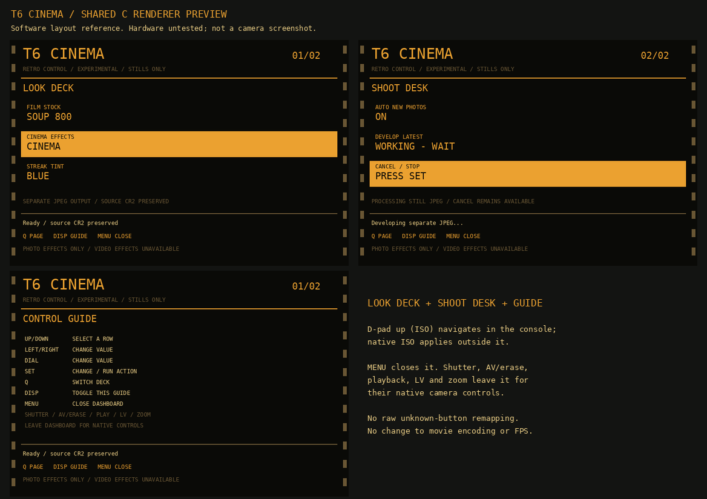

# Retro dashboard

The experimental 1300D 1.1.0 build adds **T6 Film → Retro dashboard**. Open it
with SET while outside LiveView, movie mode and capture. It starts closed at
boot. The amber console controls the existing still-JPEG processor; it does not
replace Canon's menus, exposure controls or movie encoder.

This image comes from the same C layout renderer used by the camera build.
Host fonts and colors approximate ML's bitmap fonts and palette. It is a software
layout reference, not a camera screenshot or evidence of physical button testing.

| Control while dashboard is open | Behavior |
| --- | --- |
| D-pad up/down (ISO/WB labels) | Select one of three rows, wrapping at the ends |
| D-pad left/right (drive/AF labels), dial events | Change the selected value, wrapping within its range |
| SET | Change a value; run Develop latest or Cancel on the Shoot desk |
| Q | Switch between Look deck and Shoot desk |
| DISP | Toggle the control guide |
| MENU | Close the dashboard |
| Shutter, shared AV/EV-Erase button, playback, LV, zoom | Leave the dashboard and retain native controls |
| Mode dial, power, card-cover/system events | Retain native behavior; incompatible modes close the dashboard |

Canon's [rear-button diagram, printed page 20 / PDF page 22](https://gdlp01.c-wss.com/gds/2/0300022692/01/eos-rebelt6-1300d-bim-en.pdf#page=22)
shows a **shared Aperture/Exposure compensation/Erase button**. There is a
physical Erase function; the ML port's `BGMT_TRASH` "not present" comment must
not be interpreted as the absence of that button. Canon documents its playback
use on [printed page 98 / PDF page 100](https://gdlp01.c-wss.com/gds/2/0300022692/01/eos-rebelt6-1300d-bim-en.pdf#page=100).
No new binding to the port's `BGMT_TRASH` event is added. Native playback and
Erase handling are retained; the manual does not establish a raw firmware-event
number for that physical action.

**ISO is the upper cross key**, not a separate physical button. Its dashboard
role is up-navigation, as listed above; outside the dashboard its native ISO
role remains unchanged. Likewise, the other cross keys have WB, drive/self-timer
and AF shooting shortcuts. A `BGMT_ISO` logical event, if delivered, is forwarded
to native handling; that is not a claim that pressing the upper cross key exits
the dashboard.

The [front diagram, printed page 19 / PDF page 21](https://gdlp01.c-wss.com/gds/2/0300022692/01/eos-rebelt6-1300d-bim-en.pdf#page=21)
identifies the main dial; the rear diagram shows no rear control wheel. The
adapter recognizes wheel event names already present in the pinned T6 port,
without claiming every defined event corresponds to a physical wheel axis.
Canon labels the physical information/display button **DISP.**; its display
operation appears on [printed page 46 / PDF page 48](https://gdlp01.c-wss.com/gds/2/0300022692/01/eos-rebelt6-1300d-bim-en.pdf#page=48).
`BGMT_INFO` is handled as an existing logical information event, not claimed as
an additional physical INFO button.
Unknown button events leave the dashboard without changing its settings. Normal
OLC/system notifications are forwarded without reading their object payload.

Cancel remains available while the still worker runs. Develop latest is ignored
while it is busy. A capture, half-press, movie/LiveView transition, closed menu,
changed menu selection or disabled display ends the dashboard context. Releases
matching navigation/SET/DISP presses swallowed by the console remain swallowed
after exit so Canon does not receive an unmatched release. AV/EV uses the pinned
port's existing AV decoder only for a recognized event with a non-null object;
the dashboard's AV handoff suppresses the old AV-to-ML-menu shortcut for that pair.

Drawing uses native ML custom-menu rendering and bitmap APIs, within 720×480.
Text uses ML's `NO_BG_ERASE` so glyph backgrounds preserve the filled amber
selection row. Half-shutter leaves its menu-close signal to the native handler;
the adapter and status poll do not add a second toggle request for that press.
The gate also checks the existing half-shutter state before requesting closure
for an earlier notification. In a native emulation trace, an undefined button
notification arrived after the state changed but before the named half-press
event; toggling for both would close and then reopen the ML menu. The fix does
not assign that undefined event a new physical-button meaning.
The poll only ends the custom dashboard state and requests a redraw. Incompatible
context notifications forwarded to ML likewise leave menu closure to native
handlers, preventing capture/property events from queuing two menu toggles.
Native emulation exposed another race: the named half-press handler and a
pending redraw task can both request closure. The isolated T6 build therefore
records explicit open/close/toggle intents before waking the menu task. The
task applies the latest requested state; duplicate or delayed close wakes do
not become open requests. All eight pinned producers and both consumers are
checked by the staging patch. No Canon ROM instructions are modified.
A low-priority task requests status refresh at most twice per second; it never
draws from a capture hook or touches sensor/movie registers. Worker status changes
can request an additional native menu redraw. The build script applies checked
source patches only to an isolated archive of the exact ML pin. It inserts the
gate after startup, power-save and shutdown bookkeeping, retains the rest of the
feature-handler chain, and bypasses only ML menu actions for native handoff keys.

Run `make -C src/tools/t6_worker_test retro` and `retro-asan` for the actual menu
adapter plus portable state/renderer tests. They cover inactive forwarding,
unknown/null/system payloads, AV handoff, press/release pairing, menu/mode changes,
bounded navigation, worker cancellation and drawing coordinates. They model
native services; real T6 controls, palette, task ordering and timing still need
physical validation. No camera, card, ROM or boot flag is changed by these tests.
`python3 src/tools/t6_worker_test/menu_intent_test.py --ml-source /path/to/pinned-ml --sanitize`
also compiles the actual staged request helper and menu consumer, exercising
delayed wakes and requests arriving during open/close transitions.

Rebuild the preview under Linux/WSL with
`python3 src/tools/t6_worker_test/make_retro_preview.py` after installing Pillow.
